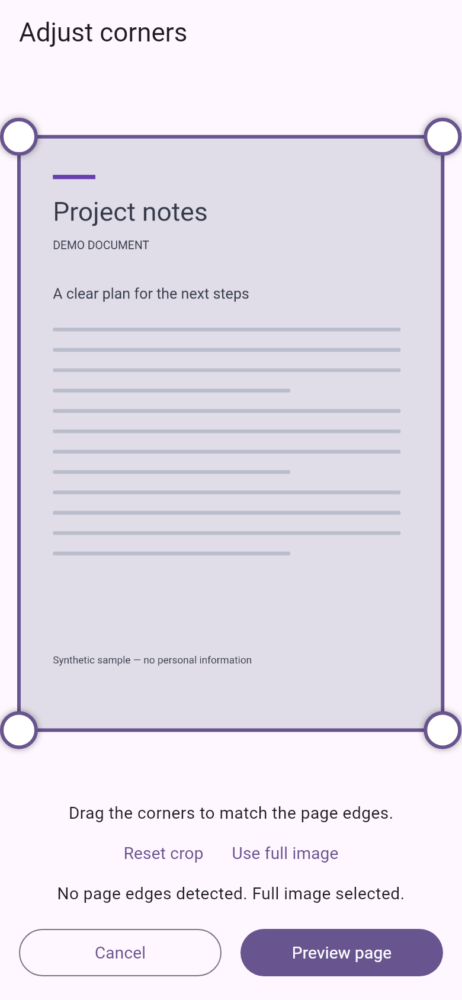
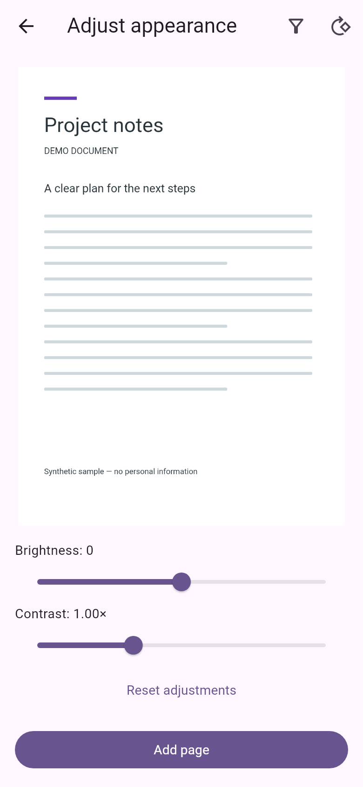

<div align="center">

# FOSScanner

**Scan documents. Keep them on your device.**

A free and open-source document scanner for Android and iOS.
Capture or import pages, straighten and adjust them, then export a PDF.
No account, no cloud processing, no tracking.

[](LICENSE)
[](https://github.com/FOSScanner/fosscanner-app/actions/workflows/ci.yml)
[](https://github.com/FOSScanner/fosscanner-app/releases/latest)

[**Download Android APK**](https://github.com/FOSScanner/fosscanner-app/releases/latest) ·
[Report an issue](https://github.com/FOSScanner/fosscanner-app/issues) ·
[Contribute](CONTRIBUTING.md)

</div>

> **Development preview:** this README describes the current source, including
> UI changes being prepared for the next release. The latest published APK may
> look different. Check the [release notes](https://github.com/FOSScanner/fosscanner-app/releases)
> for what is available to download.

## A simple scanning workflow

1. **Add pages** with the camera button, or with **Import from gallery** (in
   the toolbar, and on the empty home screen).
   On Android you can also **share** one or more images to FOSScanner from
   Gallery, Files or a messenger; they are reviewed one by one and appended to
   the current draft. **Import from PDF** (in the ⋮ menu, Android) renders the
   pages of a PDF on your device at the density of the current quality preset
   (300 DPI for High, 200 for Balanced, 150 for Small) and reviews them the same
   way, starting from the full page instead of edge detection.
2. **Check the crop.** Drag the corners to the page edges. If detection fails,
   the full image is selected rather than trimmed, and a brief notice over the
   image says so.
3. **Preview and adjust.** Choose **Preview page**; the page preview fills the
   screen. Tap the **Filters** icon for filter choices, the **Adjust** icon for
   brightness and contrast (the preview updates when you release a slider), or
   rotate. **Reset adjustments** in the Adjust sheet restores neutral
   brightness/contrast without changing your crop, filter, or rotation.
4. **Build your document.** Choose **Add page**, then scan more pages. After a
   camera capture, **Add & scan next** adds the page and reopens the camera
   right away; **Add page** (or canceling the camera) ends the series with every
   accepted page kept. On the crop step, **Retake** discards a bad shot and
   reopens the camera. Tap a
   page to zoom in and choose Edit to change its appearance. Use the editor’s
   back arrow to revisit the crop; back again leaves the editor without saving.
   Save an edit with **Save changes**.
5. **Export PDF** to the system share sheet and choose where to send or save it.
   On Android, **Save PDF to device** (next to Export) opens the system file
   picker so you can store the PDF directly, even without Google apps. PDFs are
   named like `Scan 2026-11-19 14-05.pdf` (` (searchable)` with text
   recognition); you can rename them in the picker.
   **PDF export options** sets the page size (Original, A4 or Letter) and
   quality (High, Balanced or Small); on Android it also turns searchable text
   on or off and offers **Copy text**. Your choices are remembered.

Use each page's **Reorder page** (up/down arrows) menu to **Move earlier** or
**Move later** (disabled while the document has a single page), or long-press
and drag pages to reorder them. The page grid adds columns on tablets and in
landscape. Deleting a page
offers **Undo** for ten seconds. In a multi-image gallery import, **Skip image** skips only the
current photo; remaining images are still reviewed. The review title shows
the position (for example *Image 2 of 5*), and **Stop importing** (or Back)
ends the batch while keeping pages already added. Canceling an unsaved
capture or single-image review adds no page.

## Screenshots

<table>
  <tr>
    <td align="center"><br>Review your document</td>
    <td align="center"><br>Check the crop</td>
    <td align="center"><br>Adjust the appearance</td>
  </tr>
</table>

[Empty state](docs/screenshots/ui-home-empty.png) ·
[Dark theme](docs/screenshots/ui-home-pages-dark.png) ·
[PDF export options](docs/screenshots/ui-export-options.png) ·
[Complete barcode review](docs/screenshots/barcode-complete-url.png)

*The first six images are Flutter widget renders of the current candidate using
synthetic documents. The barcode example is a separately rendered UI fixture.
They are not camera captures or demonstrations of OCR/filter quality.
[Rendering details and reproduction](docs/screenshots/README.md).*

## What it does

| Capability | Android | iOS |
|---|---|---|
| Camera capture and gallery import | Yes | Yes |
| Receive images shared from other apps | Yes | Not yet — needs a Share Extension |
| Import pages from a PDF | Yes — rendered as images | Not yet — needs a PDFKit renderer |
| Edge detection, manual crop, perspective correction | Yes | Yes |
| Original, Enhance, Grayscale, Black & white filters | Yes | Yes |
| Rotation, brightness, contrast, and later re-editing | Yes | Yes |
| Multi-page PDF export through the system share sheet | Yes | Yes |
| Save the PDF to device storage | Yes — system file picker | Via the share sheet's "Save to Files" |
| Offline searchable PDFs with selectable text | Yes — Latin-script OCR | Image-only PDFs |
| Copy recognized text to the clipboard | Yes — Latin-script OCR | Not yet |
| Temporary draft restoration after app restart | Yes | Yes |
| QR/barcode scanning and full-result inspection | Yes | Yes |
| System light/dark theme | Yes | Yes |

**Page size and quality.** *Original* sizes each page from its pixels, as
before. *A4* and *Letter* fit each page image inside the page, centered, and
turn the page to landscape for landscape images. *High* keeps full
resolution; *Balanced* (up to 200 DPI) and *Small* (up to 150 DPI, stronger
JPEG compression) make much smaller files for email and upload limits. On
*Original* pages the DPI limit is measured against an A4-sized page. The
same settings apply to searchable PDFs; lower resolutions can reduce text
recognition accuracy on fine print. The app does not predict the file size.

Perspective correction and filters use OpenCV. Searchable PDFs use bundled,
offline Tesseract data. On Android, searchable text is off by default; enable it
in **PDF export options**. The app remembers your choice in a small private
settings file, and the export button reads **Export searchable PDF** while it
is on. Recognition
quality depends on the document, language, lighting, and image quality.

**Copy text** (in **PDF export options**, Android) recognizes the text of every
page on your device, in page order, and puts it on the clipboard. Progress and
**Cancel** appear in the export bar, like a PDF export; nothing is copied if you
cancel. The clipboard entry is marked sensitive, so Android 13 and later (and
keyboards that honour the flag) do not preview it. The recognized text is never
logged or written to a file, but anything on the clipboard can be read by apps
you paste into, so clear it when you are done.

The editor keeps the last successful preview visible while processing a new
adjustment. If it fails, retry the preview before saving. PDF generation shows
progress and offers cancellation; document editing and intake pause during
generation and sharing to avoid overlapping memory-heavy operations. The export
bar keeps one height for every state, page count and text size, so the page
grid and the camera button never move while exporting. Searchable exports show
**Recognizing text** while pages are recognized. System Back does nothing while
an export runs; use **Cancel** to stop it.

Barcode results are selectable and can be copied in full. For HTTP/HTTPS links,
you can inspect the destination hostname before choosing to open the browser.

## Install

### Android

Download an APK from the [latest release's assets](https://github.com/FOSScanner/fosscanner-app/releases/latest):

- **`app-arm64-v8a-release.apk`** — for devices that support 64-bit ARM apps;
  the usual choice for modern Android phones.
- **`app-armeabi-v7a-release.apk`** — for devices that require 32-bit ARM apps.

Your browser or file manager may ask for permission to install this APK.
Use official release assets, and keep the same signing identity when updating.
Avoid uninstalling just to resolve an update problem: uninstalling removes drafts.

### iOS

Build from source on macOS with Flutter and Xcode. Installing on an iPhone or
iPad requires the appropriate Apple signing setup; the Android APK cannot be
used on iOS. See [development](#development) below.

## Privacy and your documents

**Scanning, image processing, OCR, and PDF generation run on your device.**
FOSScanner has no login, telemetry, analytics, or scan-upload service. Imported
gallery originals are not modified or deleted. App-owned camera temporary files
are cleaned up after the attempt to read them, including failed reads.

On Android 13 and later, the app's thumbnail in the Recents screen is blank so
page content is not shown when you switch apps; screenshots still work. Android
12 and earlier have no way to hide only the thumbnail, so it may show the
current screen there.

To also block screenshots and screen recording, check **Block screenshots** in
the **More options** (⋮) menu (Android). It hides the Recents thumbnail on every
Android version too. The choice is stored in the app's private settings file and
applied again each time the app starts; it is off by default.

Images shared into the app are read only through the temporary permission that
comes with the share; FOSScanner keeps no lasting access to them. Each image
(up to 32 MB, and no more than the document has room for) is copied into the
app's private cache only when it can be reviewed, and the copy is deleted once
read. If a saved draft could not be restored, shared images wait until you
retry or discard it, so they never overwrite it.

**Import from PDF** opens the system document picker and keeps no lasting
access to the chosen file. The PDF is copied into the app's private cache only
while its pages are rendered, then deleted; each rendered page is deleted once
read. Rendering stops at the document's page and memory limits, shows a
cancellable progress dialog, and never reaches the network. Pages become
images: text, links and vector graphics are not kept, but a searchable export
recognizes the text again. Password-protected or damaged PDFs are not
supported (*This PDF can't be opened.*).

### Drafts are temporary, not a backup

Unfinished documents are saved in the app's private, **OS-managed cache** so they
can be restored after a normal restart. The OS can purge this cache under storage
pressure. **Export a PDF and save it somewhere durable before relying on it.**

- A draft contains original and processed page images plus editing settings.
  Atomic saves can retain the current and one previous draft generation.
- Sharing keeps the draft by default. Choose **Clear all pages** in the ⋮ (More
  options) menu and confirm when you want to start over. Clearing app storage
  or uninstalling also removes draft data; Android OS backups do not include
  it.
- If restoration fails, adding images and draft saves are paused so they cannot
  silently replace the cached draft. Use **Retry restoration** after checking
  storage access. **Discard saved draft** requires confirmation and deletes both
  cached generations, including potentially recoverable pages; exported PDFs
  are not removed. A valid backup is recovered automatically when possible.
- If saving fails, the line above your pages shows **Draft not saved** with
  **Retry** until a save succeeds (tap the message for the full explanation).
  Keep the app open and retry; the retry saves your current pages, not an old
  snapshot.
- Unrelated notifications wait while deletion Undo is available. A new deletion
  replaces the previous Undo; export or confirmed clearing discards it.

### Sharing, saving and external links

Export opens the OS share sheet; it does not prove that another app saved or
delivered the PDF. On Android, **Save PDF to device** writes the PDF to the
location you pick in the system file picker; it needs no storage permission,
and canceling the picker changes nothing. FOSScanner writes the PDF to its private cache only for the
hand-off and deletes it when the share sheet returns; a copy left by an
interrupted export is removed at the next launch. The share system may keep
its own copy in an app/OS cache, whose lifetime is platform-managed. Receiving apps control their own copies and may upload them.

FOSScanner does not make its own network requests. Opening a scanned HTTP/HTTPS
link or the source-code link hands it to an external app, which may use the
network. Only open destinations you trust.

## Development

Use **Flutter 3.44.0 / Dart 3.12**, matching CI and `.flutter-version`.

```bash
flutter pub get
flutter run

# Checks used by CI
flutter analyze
flutter test
```

### Build from source

```bash
# Signed Android APKs; configure your release keystore first
flutter build apk --release --split-per-abi --target-platform android-arm,android-arm64

# iOS build check on macOS, without device signing
flutter build ios --no-codesign
```

For Android signing, copy and configure
[`android/key.properties.example`](android/key.properties.example). Keep the
real properties file and keystore out of git; never share signing credentials.

For a containerized **debug** Android build:

```bash
# Produces ARMv7 and ARM64 debug APKs in ./docker-output/
docker compose run --rm build-apk
```

The Docker service pins a Flutter image and uses the x86_64 Android toolchain.
Apple Silicon uses Docker Desktop emulation; native ARM64 Linux needs amd64
emulation configured. Builds are limited to two CPUs and 4 GiB RAM with no extra
swap; Gradle and OpenCV parallelism are also bounded. Leave at least 4 GiB
available. These limits contain resource use but do not guarantee every build
will finish with that memory budget.

<details>
<summary>Runtime memory limits</summary>

Image admission counts encoded buffers held by pages, pending/active draft
saves, and Undo, counting shared allocations once. Deleting a page may not free
that budget immediately. Editors and PDF export share a processing queue;
export blocks document mutation until generation and sharing finish.

These are admission estimates, not a hard process-memory limit. Decoded image
caches, native OpenCV/OCR allocations, worker copies, and the finished PDF add
memory beyond the estimate. Lower-memory device profiling is still needed.

</details>

## Contributing and security

Issues and pull requests are welcome. Follow [CONTRIBUTING.md](CONTRIBUTING.md):
branch from `dev`, target PRs to `dev`, and keep changes focused. New dependencies
must be FOSS, and document processing must stay on-device.

Report vulnerabilities using [SECURITY.md](SECURITY.md), not a public issue
containing sensitive details. Version history is in [CHANGELOG.md](CHANGELOG.md).

## License

FOSScanner is licensed under the [GNU General Public License v3.0](LICENSE).
Bundled OCR data and native dependencies have their own notices; see
[`assets/tessdata/`](assets/tessdata/) and the app's license information.
